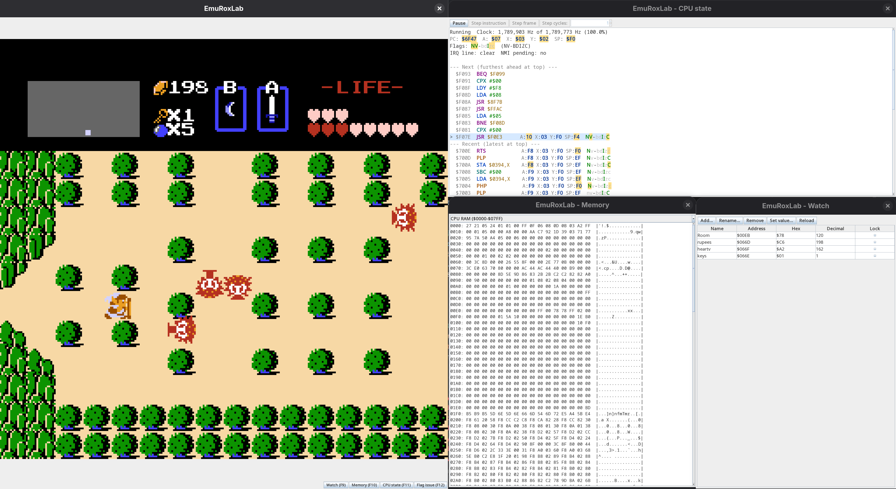

# EmuRox Lab

[EmuRox](https://github.com/rossdrew/emuRox) has gotten a little behind the times and I'm now faced with two issues on that repo
 1. Bringing everything up to date so that it works
 2. Developing it

I don't want to do #1 yet.  It's no fun.  So I've created this project to run some experiments regarding #2.  Of course starting with the [6502](https://github.com/rossdrew/EmuRoxLab/tree/main/src/main/java/com/rox/cpu) and of course making sure we build [great regression testing](https://github.com/rossdrew/EmuRoxLab/tree/main/src/test/java) in from the start.  

# How am I using AI

I began this journey by

 1. using AI A (ChatGPT Web) as an architect pair to discuss, iterate and build on the design
 2. generating extensive AI (ChatGPT CLI) unit tests (validating them manually and refining the style)
 3. using AI B (ChatGPT Web) to act as a test expert to discuss additional test options
 4. generating implementation manually and using AI where sensible (GitHub Copilot), often I find the generic AI approach is not what I need

after a little over half the opcodes were manually implemented. I believe setting a good standard, I expanded my AI use:

 1. Claude CLI using the `/plan` skill and developing a 5 part plan, grouping similar opcodes together
 2. Manually stepping through the subtasks in the plan, approving as it went
 3. Approving the whole piece of work before committing to a branch
 4. Using PR (tagged as AI work), link in AI code reviews with CodeRabbit and doing one more manual review

I'm doing less and less manual work and more periodic review.  Developing skills and tools that help me create a good product and good code without detailed manual review. Effectively, I've given this EmuRox repo over to AI experimentation, looking at if I can:
 1. Make this multi-agent. Developer, pair-programmer, reviewer & QA.
 2. Turn this into a semi-autonomous workflow based on a task list provided by myself. Work with orchestration tools to analyze and refine outputs and token usage
 3. Develop a multi-agent autonomous team where the task list is also built and my role is refinement 

# Current state of Development

We have a fully functioning emulator for certain mappers and lots of bugs. I'm pausing for now on development of features to build a good debugging story before continuing.

## Next up
1. More advanced debugging screens
2. More mapper support (UxROM, CNROM, ...)
3. Advanced game development features

## Known Issues

#### 6502
- STA_ABS_X and LDA_ABS_X: LDA_ABS_X is a read instruction, so the 6502 can optimistically try to read from the partially indexed address first; if adding X does not cross a page, that read is valid and the instruction finishes in 4 cycles, but if the low byte overflows, the CPU needs one extra cycle to fix the high byte and reread from the correct address. STA_ABS_X is a write instruction, so the CPU cannot safely do that optimistic access because an early write to the wrong address would corrupt memory; it must always spend the indexing/dummy-read cycle before performing the real write, making it 5 cycles whether or not a page is crossed.  My approach needs fully duplicated MicroOps for the case where an instruction is optionally added and the case where it is always added.
- STA_IND_Y and STA_ABS_Y: same as above
#### APU
- Testing actual hardware calls is difficult so we take a small hit on mutation coverage there
- DMC sample fetches don't stall the CPU for 1-4 cycles as real hardware does, which may affect games that depend on exact DMC DMA timing
#### Cartridges / Mappers
- Only some [mappers](src/main/java/com/rox/cartridge/README.md) are implemented; other common mappers aren't yet.  Loading one fails with a clear "unsupported mapper" error rather than silently misbehaving
#### PPU
- Headless only: no pixel rendering or framebuffer yet, though the full CHR/nametable/palette memory space and OAM DMA are wired up
- OAM DMA always stalls the CPU for a fixed 514 cycles rather than the real hardware's cycle-accurate 513/514 (odd/even alignment isn't tracked), which may affect cycle-sensitive software
- Four-screen nametable mirroring isn't modeled (only horizontal/vertical/single-screen)

# The Build System
1. Builds the code using Gradle and Kotlin
2. Uses JaCoCo to build code coverage data and Codecov to build a report from it
3. Uses pitest for mutation testing, with the badge and report published by [Pitest Badge](https://github.com/marketplace/actions/pitest-badge)
   1. only runs manually or when '+fullBuild' is in the commit message
   2. expensive so can be run on a subset using `-PpitestScope=com.rox.apu.*` 
4. Will skip builds on non code changes
5. Using [CodeRabbit](https://app.coderabbit.ai/) for automated AI code reviews on PRs
